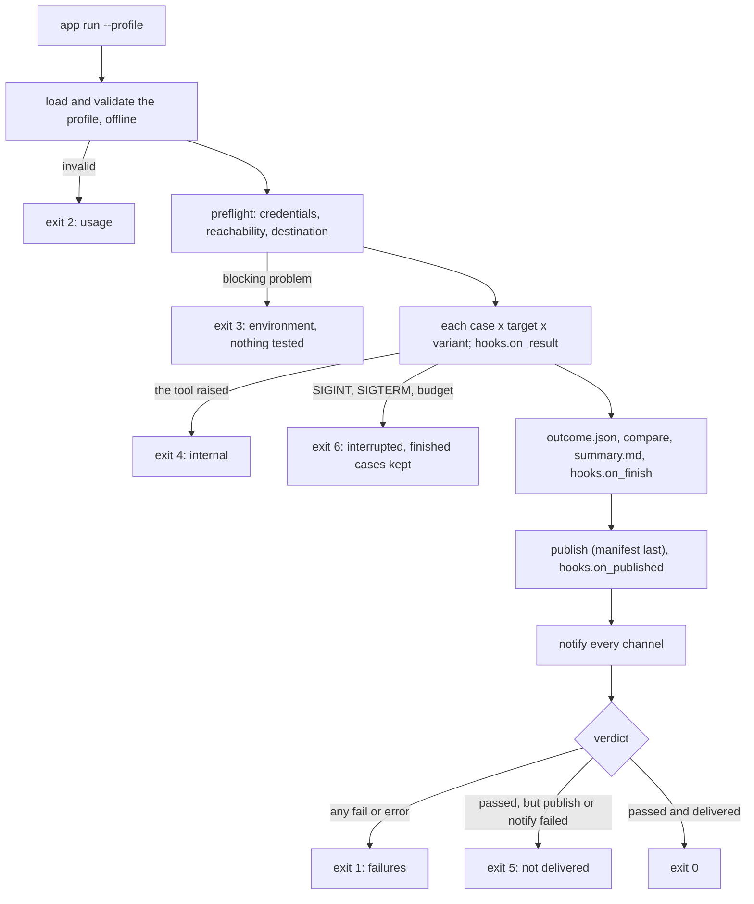

# Architecture

How the code is laid out, for people changing the framework or reading it to extend it well.
To extend it, see [Extending](extending.md); for why it is shaped this way, [Design](design.md);
for the public API module by module, the [package reference](../src/cli_framework/README.md).

## A run, end to end



Publication and notification run whichever way verification ended; a failed verdict is never
replaced by 5.

## The data (`model.py`, `report.py`, `compare.py`)

Every file a run writes is a serialised typed record, read back with `from_dict`:

| Type | File | What |
|---|---|---|
| `ResultRecord` | `results.jsonl` | one case: `CaseKey` (target, case, variant), `Verdict`, `Check`s, skip class, labels |
| `RunOutcome` | `outcome.json` | the run: exit code and label, `Counts`, skips by class, `Failure`s, preflight `Problem`s, `Publication`, group, links |
| `Comparison` | `comparison.json` | `Change`s of a `ChangeKind` against baseline runs |
| `RunReport` | notifications | what is said about a run: built from the outcome and comparison; every channel renders it |

Enums, not strings: `Verdict`, `ExitCode` (an IntEnum: it is the process status), `Severity`,
`PublicationStatus`, `ChangeKind`. Schemas are versioned (`cli_framework.results/1`, ...): adding a
field is compatible; renaming or removing one needs a new version.

## The library (`src/cli_framework/`)

| Module | Responsibility |
|---|---|
| `cli.py` | `App` (argparse, shared flags, exception to exit-code mapping, SIGTERM as interrupt), the `Command` protocol |
| `commands.py` | built-ins `publish`, `compare`, `notify`, `job`; `add_run_arguments` and typed `RunOptions` for an app's `run` |
| `session.py` | one run end to end; `Baseline` and `compare_with_archive` |
| `runner.py` | `CaseRegistry`, `Case`, `Selector` (patterns and tags), `Context`, `Runner` (serial by default; opt-in workers and case timeouts) |
| `hooks.py` | `RunHooks` lifecycle observers, `HookChain`, `ProgressLog` |
| `outputs/` | opt-in hooks: `HtmlReport`, `JUnitReport`, `MetricsFile` |
| `evidence.py` | the check journal: record, then decide |
| `model.py` | the typed records above, `SkipClasses` |
| `report.py` | `RunReport` and the Markdown summary |
| `compare.py` | the transitions, windows and flaky cases |
| `rundir.py` | file names, redacting writers, typed readers, the manifest |
| `sinks.py` | the `Sink` protocol, `file://` and `s3://`, registered in `PLUGINS.sinks` |
| `publish.py` | `deliver` (manifest last), `Archive` (reading published runs back) |
| `notifiers/` | the `Notifier` protocol, registered in `PLUGINS.notifiers`, spec parsing; built-ins `slack`, `webhook`, `exec`, `file`, `log` |
| `preflight.py` | `Problem`s with a kind and severity; ready-made checks |
| `profile.py` | profile formats registered in `PLUGINS.profile_loaders` (YAML by default; TOML and JSON), the `Problems` collector, digest |
| `settings.py` | `<PREFIX>_<KEY>` environment settings, named in one place |
| `plugins.py` | `PluginRegistry` (named factories, entry-point discovery) and `PLUGINS`, every extension point in one object |
| `layout.py` | `RunFile` and `Schema`: every file name and schema id |
| `defaults.py` | `Defaults` and `RetryPolicy`: every tunable, immutable |
| `redact.py` | `Redactor`, and the one process-wide instance `REDACTOR` |
| `log.py` | two streams, handler-level redaction, `LogSetup` |
| `retry.py` | bounded retries, for deliveries only |
| `kube.py` | read-only kubectl/oc adapter |
| `exit_codes.py` | `ExitCode` (with its status), `combine` |

Dependencies: the standard library and PyYAML. `boto3` (extra `s3`) is imported only where
used.

### State

Module-level state is three objects, all deliberate:

| Object | What | Why it is process-wide |
|---|---|---|
| `REDACTOR` (`redact.py`) | the secrets to scrub | secrets and logging are process-wide; every API that redacts also accepts its own `Redactor` |
| `PLUGINS` (`plugins.py`) | `.notifiers`, `.sinks`, `.profile_loaders` | that is what makes a plugin one registration; a name cannot be registered twice unless `replace=True` |
| `DEFAULTS` (`defaults.py`) | timeouts, retry policy, truncation limits | immutable; build another with `dataclasses.replace` |

Names live on types, not in loose constants: run file names and schema ids are the `RunFile` and
`Schema` enums (`layout.py`); each `ExitCode` carries its label, headline and meaning; each
`ChangeKind` its heading; the default skip vocabulary is `SkipClasses.default()`. Logging
configuration is a `LogSetup` that the `App` holds.

## Concurrency (opt-in)

With `workers > 1`, worker threads only execute cases and hand back records; the runner's own
thread writes `results.jsonl` and calls every hook, so hooks never need locks. `RunDir` writes
are serialised, because cases share files such as `exchanges.jsonl`. Workers are daemon
threads, so a hung case never keeps the process alive, and the budget stops new cases in every
worker. Cases marked `exclusive` run alone after the concurrent ones. `run_all` returns
records in plan order; `results.jsonl` is in completion order, which nothing depends on
because readers key records by `CaseKey`.

A timed-out case cannot be stopped (Python has no way to kill a thread): it is recorded as an
`error`, marked abandoned so its later evidence writes are dropped, and left to finish in the
background.

## Extension points

Each is additive: no cli-framework change, no fork.

| To add | Do | Discovered by name from |
|---|---|---|
| a **notification channel** (Teams, Discord, email, PagerDuty, a ticket system) | a class with `name` and `send(report)`, built from a target string; `PLUGINS.notifiers.register("teams", TeamsNotifier)` | `--notify teams:env:TEAMS_URL`, `<PREFIX>_NOTIFY`; entry point group `cli_framework.notifiers` |
| a **results store** (GCS, Azure Blob, an upload API) | implement `Sink`; `PLUGINS.sinks.register("gs", GcsSink)` | the destination URI's scheme; group `cli_framework.sinks` |
| a **profile format** (Jsonnet, CUE, HCL) | a `text -> mapping` function; `PLUGINS.profile_loaders.register("jsonnet", load)` | the file suffix; group `cli_framework.profile_loaders` |
| **live reporting** (metrics, a database, a live table, an extra report file) | subclass `RunHooks`; add it to `Session(hooks=[*options.hooks(), yours])` | code |
| a **case** | `@REGISTRY.case("group.what", needs=..., variants=..., tags=...)` | `-k`, `--tag`, `--exclude-tag` |
| a **skip class** | `App(skip_classes=SkipClasses.default().extend(SkipClass(...)))` | `ctx.skip(name, reason)` |
| a **preflight check** | a callable returning `Problem`s | `Session(checks=...)` |
| a **command** | a class with `name`, `help`, `passthrough`, `add_arguments(parser, app)`, `run(args, app)`; `app.add(...)` | the CLI |
| a **setting** | `app.settings.get("MY_KEY")` reads `<PREFIX>_MY_KEY` | the environment |
| a **different test engine** (pytest, a load generator, an external harness) | keep `Session`'s shell and write `ResultRecord`s from your engine (`RunDir.add_result`), or replace `Session._verify` in a subclass | code |

A notifier spec is `<kind>:<target>`; `env:NAME` reads the target from a variable and
registers it as a secret. Channels are independent: one failing does not stop the others, and
a failed delivery turns an otherwise passing run into exit 5.

## A tool (`examples/modelcheck/`, `examples/httpcheck/`)

Both examples have the same shape, which `scripts/new-app.sh` copies:

| Module | Responsibility |
|---|---|
| `profile.py` | the tool's typed profile, validated with `Problems` ([Profiles](profiles.md)) |
| `client.py` | a recording client for the protocol under test (here HTTP) |
| `cases/` | one module per group of cases, registered into `REGISTRY` by being imported in `cases/__init__.py` |
| `cli.py` | the tool's `run` (builds a `Session` from `RunOptions`) and `profile` commands, plus the built-ins |
| `tests/fake_*.py` | a real local server with switchable defects: every case is proven to fail against one |

## Testing

What CI runs on every change, after `scripts/install.sh --dev`:

```sh
.venv/bin/ruff check . && .venv/bin/ruff format --check .
.venv/bin/mypy src/cli_framework examples/httpcheck/src examples/modelcheck/src
.venv/bin/python -m pytest -q        # tests/ and both examples' tests
demo/local/run.sh                    # the local demo, end to end
```

CI also renders the Kubernetes manifests, runs shellcheck on every script and builds the image;
`kind-demo.yaml` runs the kind demo and its checks.
