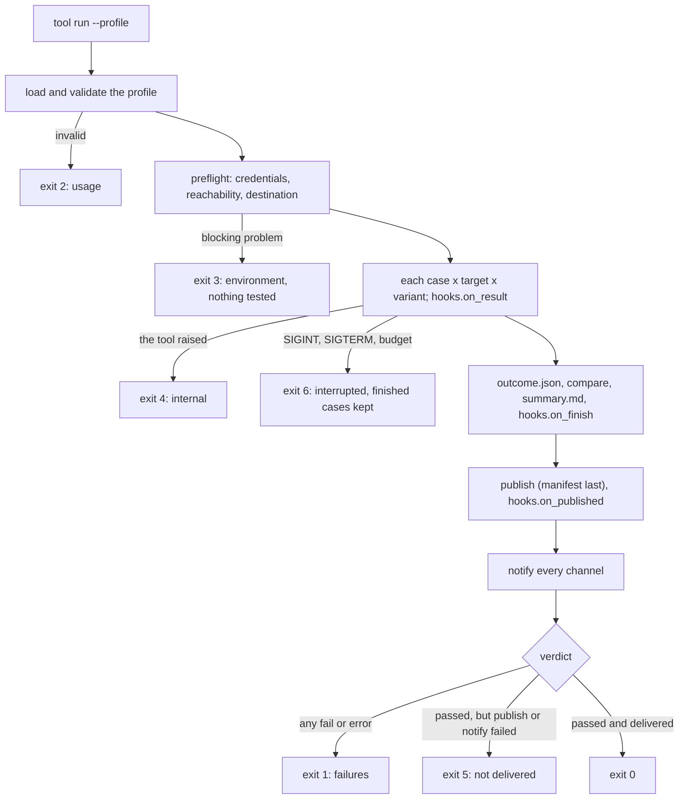

# Architecture

Reference for developers working on the framework itself: how a run proceeds, how the package
is organised, the design rules the code follows, and how changes are verified. To build a tool
on the framework, start with [Getting started](getting-started.md); to add plugins, see
[Extending](extending.md).

## A run, end to end



Publication and notification run however verification ended, and a failed verdict is never
replaced by exit code 5.

In code:

```
App.main()                                    cli.py: arguments, logging, exit codes
  └─ tool's RunCommand.run()                  the tool: load the profile, build the Session
       ├─ RunOptions.from_args()              commands.py: standard flags to typed options
       └─ Session.execute()                   session.py
            ├─ preflight.run(checks)          preflight.py
            ├─ Runner.run_all(cases, targets) runner.py: each case x target x variant
            │    └─ case(ctx)                 the tool's checks; evidence.py records each one
            ├─ RunOutcome, summary.md         model.py, report.py
            ├─ compare_with_archive()         compare.py, publish.Archive
            ├─ hooks.on_finish()              hooks.py, outputs/, layers.LayerLocator
            ├─ publish.deliver()              publish.py, sinks.py
            └─ notify_all()                   notifiers/
```

`job` runs the tool's `run` command as a child process, then compares, publishes and notifies
itself, so delivery happens even if the run crashes or overruns its budget.

## Package layout (`src/va/`)

| Module | Provides |
|---|---|
| `cli.py` | `App` (argument parsing, shared logging flags, exception to exit code mapping, SIGTERM handled as an interrupt), the `Command` protocol, `run_app` |
| `commands.py` | the built-in `publish`, `compare`, `notify` and `job` commands; `add_run_arguments` and `RunOptions` for a tool's `run` command |
| `settings.py` | `Settings` and `Key`: every `<TOOL>_<KEY>` environment setting, named once |
| `session.py` | `Session` (one run from preflight to exit code), `Baseline`, `compare_with_archive` |
| `runner.py` | `CaseRegistry`, `Case`, `Selector`, `Context`, `Runner` (serial by default; opt-in workers and timeouts), the `Target` protocol |
| `evidence.py` | the check journal: `check`, `require`, `fail` |
| `layers.py` | `LayerKinds`, `LayerAdapter`, `LayerLocator`: targets as the layers of one stack |
| `preflight.py` | `Problem`s with a kind and severity, and the standard checks |
| `hooks.py` | `RunHooks`, `HookChain` (isolates hook failures), `ProgressLog` |
| `outputs/` | opt-in hooks: `HtmlReport`, `JUnitReport`, `MetricsFile` |
| `profile.py` | `load` (format by file suffix), the `Problems` collector, `digest`, `resolve_env` |
| `model.py` | the typed run records (`ResultRecord`, `RunOutcome`, `Verdict`, `Check`, `CaseKey`, `Counts`, `SkipClasses`, ...) |
| `rundir.py` | `RunDir`: redacting writers, typed readers, the manifest |
| `layout.py` | `RunFile` and `Schema`: every file name and schema identifier |
| `report.py` | `RunReport`: what is said about a run, rendered by every channel |
| `compare.py` | `compare`, `Comparison`, `ChangeKind` |
| `exit_codes.py` | `ExitCode` (each with a label, headline and meaning), `combine` |
| `sinks.py` | the `Sink` protocol, `file://` and `s3://` |
| `publish.py` | `deliver` (manifest last, never raises), `Archive` (reads published runs) |
| `notifiers/` | the `Notifier` protocol, spec parsing, and the `slack`, `webhook`, `exec`, `file` and `log` notifiers |
| `retry.py` | bounded retries, used for deliveries only |
| `log.py` | `configure`, `get_logger`, `emit`; redaction on every handler |
| `redact.py` | `Redactor` and the process-wide `REDACTOR` |
| `plugins.py` | `PluginRegistry` and `PLUGINS` (`notifiers`, `sinks`, `profile_loaders`), with entry-point discovery |
| `defaults.py` | `Defaults` and `RetryPolicy`: every tunable, immutable |
| `kube.py` | `KubeContext`: a read-only `kubectl`/`oc` adapter |

The names exported from `va` (`from va import ...`) are the public API. Other names may change
between minor versions before 1.0.

The package depends on the standard library and PyYAML. `boto3`, from the `s3` extra, is
imported only when publishing to S3.

### Run files

Every file a run writes is a serialised dataclass that reads back with `from_dict`:

| Type | File | Content |
|---|---|---|
| `ResultRecord` | `results.jsonl` | one case on one target: `CaseKey`, `Verdict`, `Check`s, skip class, labels |
| `RunOutcome` | `outcome.json` | the run: exit code, `Counts`, skips by class, failures, preflight problems, publication, group, links |
| `Comparison` | `comparison.json` | changes against baseline runs |
| (layers) | `layers.json` | the declared stack and where each failure starts |

Schemas are versioned (`va.results/1`, ...). Readers ignore unknown fields, so adding a field is
compatible; renaming or removing one requires a new version, because published runs outlive
the code that wrote them.

### State

Module-level state is limited to three objects:

| Object | Content | Reason |
|---|---|---|
| `REDACTOR` | registered secrets | secrets and logging are process-wide; APIs that redact also accept their own `Redactor` |
| `PLUGINS` | notifier, sink and profile-format registries | registration by name is what makes a plugin a single class |
| `DEFAULTS` | timeouts, retry policy, truncation limits | immutable; derive another with `dataclasses.replace` |

Configuration is held by objects the tool owns (`App`, `Settings`, `LogSetup`). File names,
schema identifiers, exit code descriptions and the default skip classes are defined on enums
and types rather than as loose constants.

### Concurrency

With `workers > 1`, worker threads only execute cases; the runner's own thread writes
`results.jsonl` and calls every hook, so hooks need no locking. `RunDir` writes are serialised.
Workers are daemon threads, so a hung case cannot keep the process alive. Cases marked
`exclusive` run alone after the concurrent ones. A timed-out case cannot be stopped, because
Python cannot kill a thread: it is recorded as an `error`, marked abandoned so later evidence
writes are discarded, and left to finish in the background.

## Design rules

These rules are relied on throughout the code and by tools built on it. Changes that break
one need a strong reason.

1. **Exit codes attribute failures.** `1` means the target failed cases; it is never used for
   an environment problem (`3`). Delivery failure (`5`) never replaces a failing verdict
   (`exit_codes.combine`). `ExitCode.OK` is `0`, so never test an exit code for truthiness.
2. **Preflight runs before any case.** Credentials, reachability and the results destination
   are checked first, and every problem is reported together, so a broken environment costs
   seconds rather than a full run.
3. **Profiles declare correct behaviour.** The run measures the target against the profile. A
   case whose `needs` are not declared is skipped as `undeclared`, never passed. Committed
   profiles name environment variables, never addresses or credentials. An invalid profile
   reports every problem in one pass and exits 2. A digest of the profile is recorded with
   each run.
4. **Cases are independent of targets.** A case receives a target and does not branch on its
   identity, so one case yields one comparable result per target.
5. **Evidence is recorded before the verdict.** `check`, `require` and `fail` record the
   observed and expected values on passes and failures alike. Clients record each exchange.
6. **Skips are classified.** `undeclared`, `not_implemented`, `requires_instrumentation`,
   `excluded_by_policy` and `throttled` are kept distinct, so a report never shows a gap as
   coverage. Tools can add classes.
7. **Requests under test are not retried; deliveries are.** A retry could hide the failure a
   case is checking. Uploads and notifications are retried within bounds by `retry.call`.
8. **Runs are written locally, then published, manifest last.** A run is complete in storage
   exactly when `MANIFEST.json` is present, and readers list only complete runs. Publication
   happens however the run ended.
9. **Logging is redacted at the handlers.** Diagnostics go to stderr; primary output goes to
   stdout through `emit`. Redaction filters sit on handlers, because a logger's filter does
   not see its child loggers' records. Run files and notifications are redacted as they are
   written. Secrets are registered as they are read (`REDACTOR.secret_from_env`, or a
   notifier's `env:NAME` target). `print` is not used (ruff `T20`).
10. **The framework never modifies the system it measures.** `kube.py` allows only read verbs;
    a tool that must write uses a separate, explicit adapter.
11. **The unattended parent owns delivery.** `job` runs `run` as a child with a budget shorter
    than its own, and strips its delivery settings from the child's environment, so each run
    is published and notified exactly once, even if the child crashes.
12. **Comparisons distinguish four transitions:** regression, recovery, lost evidence (a
    verdict became a skip) and new evidence. A run with no cases is never treated as a pass.
    Only runs labelled as baselines (for example `trigger=nightly`) are compared against.
13. **Commands are thin.** They parse arguments and call library functions, so the library
    works without the CLI. argparse is used because `parse_known_args` forwards unknown
    arguments cleanly and output stays within the logging system.
14. **Every case is proven to fail.** Tests run against a real local server with injectable
    defects, not mocks, and each case is shown to fail against its defect with the deciding
    check recorded as failed.
15. **Clients use the raw protocol.** An SDK can normalise away malformed bodies, statuses and
    headers that a check needs to see. Where SDK compatibility is itself under test, pin the
    SDK version exactly.
16. **Vendors are plugins.** Notification channels, results stores and profile formats are
    registered by name and chosen by configuration; the core has no vendor-specific code.
17. **Optional features stay off by default.** Concurrency, timeouts and extra outputs change
    what a run measures or costs, so they are enabled explicitly.
18. **Images are reproducible.** Dependencies are installed from a hash-checked lock file, then
    the tool with `--no-deps` and `pip check`.

## Development

Set up a virtual environment with the framework, both examples and the development tools:

```sh
scripts/install.sh --dev
```

CI runs the following on every change:

```sh
.venv/bin/ruff check . && .venv/bin/ruff format --check .
.venv/bin/mypy src/va examples/httpcheck/src examples/modelcheck/src
.venv/bin/python -m pytest -q        # tests/ and both examples' tests
demo/local/run.sh                    # the local demonstration, end to end
```

CI also renders the Kubernetes manifests, runs shellcheck on every script and builds the
image; `kind-demo.yaml` runs the Kubernetes demonstration.

Every module, class, function and method has a Google-style docstring (PEP 257, with `Args:`,
`Returns:`, `Raises:` and `Attributes:` sections where they apply); constructor arguments are
documented in the class docstring. Ruff's pydocstyle rules enforce this for public names.

A change to a case or a capability needs a defect in the example's fake server and a test that
shows the case failing against it. A change to the framework's behaviour needs a test in
`tests/`.

Versions follow `va.__version__`. Until 1.0, a minor version may change behaviour; tools pin a
commit and should review the commit history before moving the pin.
